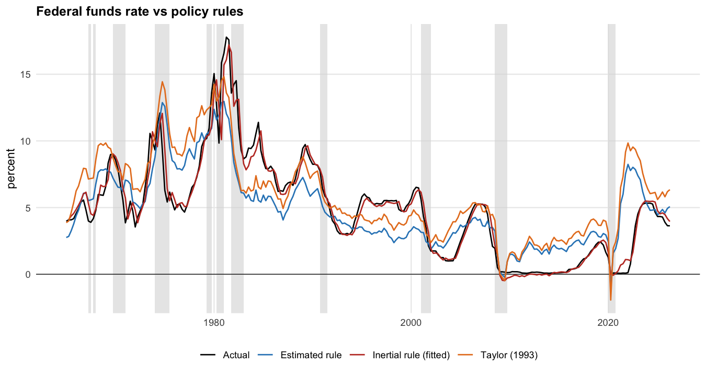
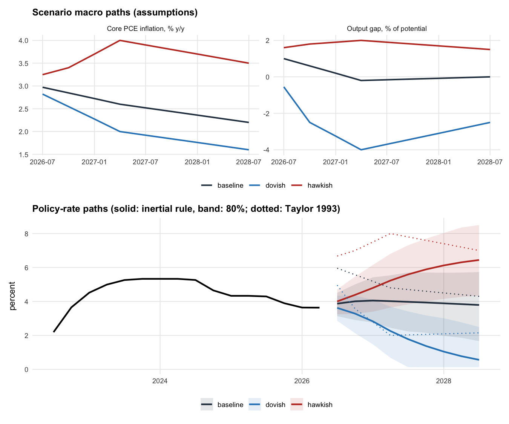
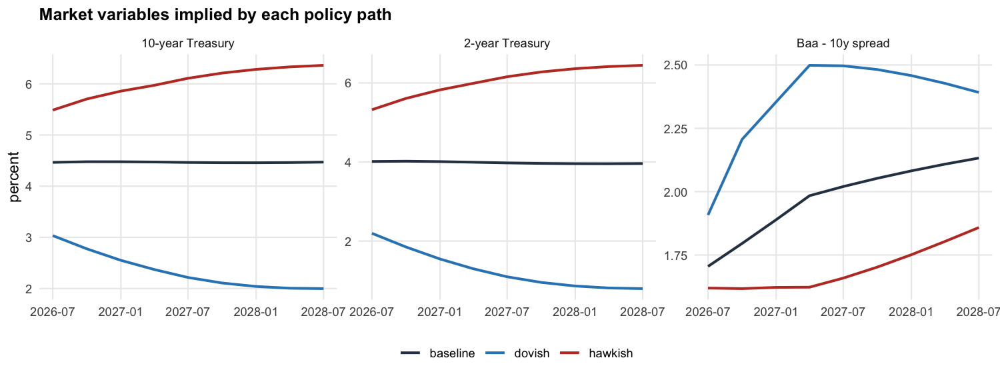
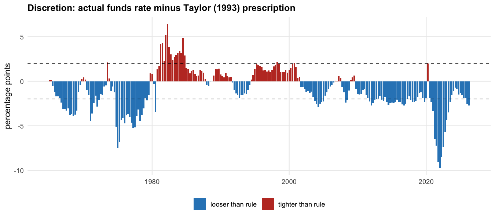
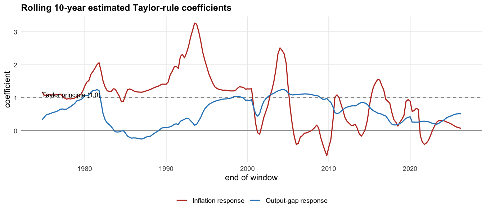

# Quantitative Analysis of US Monetary Policy (R)

Taylor-rule and autoregressive models of the **federal funds rate**, built in R on 60 years of FRED data. The
models are used to:
1. measure how systematic Fed policy has been, and where it was discretionary
2. project **nine-quarter policy-rate paths** under baseline, hawkish and dovish macro scenarios, laid out like
   the Federal Reserve's CCAR/DFAST stress tests
3. translate those paths into **Treasury yields, duration risk and credit-spread risk** for a fixed-income
   portfolio

Model limitations (high inflation, the zero lower bound, structural breaks) are documented as they would be for
model-risk governance.



## Headline results

| | Result |
|---|---|
| Share of policy-rate variation explained | **98.2%** (monthly) and **95.2%** (quarterly) by the inertial Taylor rule, 1965–2026 |
| … of which is just persistence | an AR(1) on the lagged rate alone explains **98.1%** / **94.3%** |
| … on rate *changes* | the rule explains **5.3%** of monthly and **17.8%** of quarterly changes |
| Plain Taylor (1993) rule | 49.4% of the level (61.0% over 1987–2008) |
| Estimated policy response (long run) | inflation **1.63**, output gap **1.51**; satisfies the Taylor principle (> 1) |
| Rate persistence | smoothing ρ = **0.90** a quarter, a half-life of **6.8 quarters** |
| Out-of-sample, 4 quarters ahead (2000–2026) | RMSE **1.20pp** for the inertial rule vs 1.53pp for a random walk and 1.68pp for AR(4) |
| Model limits | Errors roughly **3× larger when core inflation > 4%**. In 2021–23 the Fed ran an average **5.8pp below** the Taylor (1993) prescription, up to 9.7pp. Breaks in 1979Q3, 1991Q3 and 2001Q3. |
| Today (2026Q2) | The funds rate (3.63%) sits **2.6pp below** the Taylor (1993) prescription |
| Funds rate in 2028Q3 | baseline **3.79%**, hawkish **6.44%**, dovish **0.56%** |
| Price P&L on a $300m 2y/10y/Baa portfolio | baseline **−$4.6m**, hawkish **−$34.1m**, dovish **+$42.7m** |

All numbers come from [`output/REPORT.md`](output/REPORT.md), which `run_analysis.R` regenerates from the data.

## Why "99%" needs a caveat
- **The headline R² mostly reflects persistence.** The policy rate is extremely persistent, so almost any model
  that includes last period's rate explains about 95–99% of its *level*: 98% monthly, 95% quarterly. An AR(1)
  with no economics in it does nearly as well (98.1% / 94.3%).
- **What the economics adds:**
  - **Changes:** the rule explains 5–18% of the *changes* in the rate, which is what traders actually forecast.
  - **Forecasts:** it beats a random walk out of sample, especially 4 quarters ahead (RMSE 1.20 vs 1.53pp).
  - **Interpretable responses:** inflation and slack coefficients that can drive scenarios.
- **How it is reported:** both the level and the change R² are given, so the 95–98% figure is never presented on
  its own.

## Data (FRED, downloaded without an API key)

| Variable | FRED series | Use |
|---|---|---|
| Federal funds rate | `FEDFUNDS` | policy rate (monthly, averaged to quarters) |
| Core PCE inflation | `PCEPILFE` | inflation in the rules (year over year) |
| Output gap | `GDPC1`, `GDPPOT` | real GDP vs CBO potential |
| Unemployment gap | `UNRATE`, `NROU` | Okun's law, scenario unemployment |
| Treasury yields | `TB3MS`, `GS2`, `GS10` | yield models, duration risk |
| Credit spreads | `BAA10YM`, `AAA10YM` | Moody's Baa/Aaa minus the 10-year Treasury |
| Headline PCE, CPI | `PCEPI`, `CPIAUCSL` | reference |

- **Samples:** quarterly 1965Q1–2026Q2 (246 quarters); monthly 1965-01 to 2026-05 (737 months).
- **Jump-off:** the scenarios start from **2026Q2**, the last quarter with GDP.
- **Credit spreads:** FRED now keeps only three years of the ICE high-yield and investment-grade OAS indices, so
  the longer Moody's spreads are used.

## Methodology

### 1. Policy rules ([`R/models.R`](R/models.R))
- **Taylor (1993):** iₜ = 2 + πₜ + 0.5(πₜ − 2) + 0.5·gapₜ, with fixed coefficients.
- **Estimated rule:** iₜ = α + β_π πₜ + β_y gapₜ, using OLS with Newey-West (HAC) standard errors. It is
  estimated on the full sample and on 1987Q3–2008Q2, the conventional pre-zero-lower-bound benchmark.
- **Inertial rule (partial adjustment):** iₜ = ρ·iₜ₋₁ + (1−ρ)(α + β_π πₜ + β_y gapₜ) + εₜ.
  - It is estimated in reduced form, with long-run responses β = γ/(1−ρ) and delta-method standard errors.
  - It is fitted on quarterly and monthly data. The monthly version interpolates the output gap between quarters.

### 2. Autoregressive models
- **Fitting:** AR(p) on the funds-rate level, with orders 1–8 compared on a common sample and the order chosen by
  BIC (AR(4)).
- **Persistence by era:** AR(1) is fitted separately for each Fed chair (Martin through Powell), giving ρ, a 95%
  interval and the half-life.

### 3. Forecast evaluation ([`R/evaluation.R`](R/evaluation.R))
- **Design:** expanding-window, pseudo out-of-sample forecasts from 2000Q1, at 1 and 4 quarters ahead, comparing
  the random walk, the AR model and the inertial rule.
- **Conditional forecast:** the rule forecasts use the macro data that actually materialised. That is a
  *conditional* forecast, which is exactly how the rule is used in scenario analysis.

### 4. Model limitations
- **Fit by regime:**
  - core inflation above or below 4%
  - the Great Inflation and the Volcker disinflation
  - the Great Moderation and zero-lower-bound quarters
  - the 2021–23 surge
  - the largest output-gap swings
- **Structural breaks:** Bai-Perron breakpoints and a sup-F test (`strucchange`), plus 10-year rolling
  coefficients.
- **Discretion episodes:** periods of 2+ quarters where the funds rate was more than 2pp away from the Taylor
  (1993) prescription.

### 5. CCAR/DFAST-style scenarios ([`R/scenarios.R`](R/scenarios.R))
- **Scenarios:** nine quarters (2026Q3–2028Q3) of core PCE inflation and output gap, as baseline plus two
  alternatives.

| Scenario | Narrative | Core PCE (q4 → q9) | Output gap (q2 → q4 → q9) |
|---|---|---|---|
| Baseline | Disinflation continues; growth near potential | 2.6% → 2.2% | → −0.2% → 0.0% |
| Hawkish | Inflation re-accelerates; overheating | 4.0% → 3.5% | 1.8% → 2.0% → 1.5% |
| Dovish | DFAST-style recession | 2.0% → 1.6% | −2.5% → −4.0% → −2.5% |

- **Rate paths:** the inertial rule is iterated along each path, floored at the effective lower bound (0.125%),
  with an 80% band from 2,000 residual-bootstrap paths.
- **Unemployment:** derived from an estimated Okun's law (unemployment gap = 0.30 − 0.63 × output gap).
- **Output table:** [`output/tables/ccar_scenario_table.csv`](output/tables/ccar_scenario_table.csv) follows the
  layout of the Fed's published scenario files.

### 6. Market and credit risk ([`R/markets.R`](R/markets.R))
- **Yields:** an expectations regression links each Treasury yield to the average funds rate over the next 8
  quarters (a perfect-foresight proxy for the expected path) plus core inflation, estimated over 1987Q3 onward.
  - 2-year yield: coefficient 1.00 on the expected path, R² 0.86.
  - 10-year yield: coefficient 0.80, R² 0.70.
  - The market at jump-off is assumed to price the baseline path.
- **Short-run pass-through:** a 1pp change in the funds rate moves the 2-year yield by 0.65pp and the 10-year by
  0.29pp within the quarter.
- **Credit spreads:** five candidate Baa-spread models were compared by BIC. The chosen model has the lagged
  spread, change in the output gap, output gap and change in the funds rate (R² 0.85). The comparison table is
  saved as model documentation.
- **Duration risk:** a $100m position each in the 2-year Treasury, 10-year Treasury and 10-year Baa corporate.
  Price P&L is −D·Δy + ½·C·Δy², with spread duration applied to spread changes.

## Results

### Scenario paths (end of horizon, 2028Q3)

| Scenario | Funds rate (80% band) | Taylor 1993 | 2-year | 10-year | Baa spread |
|---|---:|---:|---:|---:|---:|
| Baseline | 3.79% (1.66–5.73) | 4.30% | 3.96% | 4.47% | 2.13% |
| Hawkish | 6.44% (4.34–8.50) | 7.00% | 6.45% | 6.36% | 1.86% |
| Dovish | 0.56% (0.12–2.50) | 2.15% | 0.80% | 2.00% | 2.39% |



**Baseline:** the estimated rule first lifts the funds rate (to a 4.05% peak) even though inflation is easing.
With core inflation at 3.1% and a +1.4% output gap at jump-off, the rule says policy is too loose, consistent
with today's 2.6pp gap to the Taylor (1993) prescription.

### Fixed-income P&L ($m, price return over nine quarters)

| Scenario | 2y Treasury | 10y Treasury | 10y Baa corporate | Portfolio |
|---|---:|---:|---:|---:|
| Baseline | 0.0 | −0.4 | −4.3 | **−4.6** |
| Hawkish | −4.6 | −14.3 | −15.3 | **−34.1** |
| Dovish | +6.3 | +21.9 | +14.6 | **+42.7** |

- **Duration:** this is the dominant risk. A hawkish policy path costs about $14m per $100m of 10-year duration.
- **Credit:** in the recession scenario, wider spreads (+77bp) take back a third of the rate rally on the
  corporate bond.



### Systematic rules vs Fed discretion

| Episode | Deviation from Taylor (1993) |
|---|---|
| 1974Q4–1978Q4 | 4.6pp looser on average (the Great Inflation) |
| 1981Q2–1984Q4 | 3.6pp **tighter** (Volcker) |
| 2003Q4–2005Q1 | 2.5pp looser ("considerable period") |
| 2014Q2–2017Q1 | 2.4pp looser (slow lift-off) |
| 2020Q4–2023Q3 | **5.8pp looser, up to 9.7pp** (the "transitory" period) |
| 2026Q1–2026Q2 | 2.6pp looser |



### Model limitations (for model-risk governance)
- **High inflation breaks the rules.**
  - The fixed Taylor (1993) rule's error rises from 1.9pp (inflation ≤ 4%) to 3.8pp (> 4%).
  - The inertial rule's error rises from 0.44 to 1.29pp.
  - The largest misses are in the Volcker disinflation and in big output swings (up to 5.8pp).
- **Unstable coefficients.** Bai-Perron finds breaks in 1979Q3, 1991Q3 and 2001Q3 (sup-F 128, p < 0.001). The
  rolling 10-year inflation response:
  - hovers around 1 (0.96–1.20) in windows ending in the 1970s
  - peaks at 3.3 in the 1990s
  - turns negative in windows that include the zero-lower-bound years
  - stays below 1 (−0.41 to 0.90) throughout the 2020s
- **Zero lower bound.** The rule prescribes negative rates in 2009–15 and 2020. Projections are floored at
  0.125%, and no shadow rate is modelled.
- **Uncertainty bands are wide.** They resample residuals from 1965–2026, including the volatile 1970s–80s, so
  the 80% band is conservative: about ±2pp at nine quarters.
- **Revised data.** The models use today's revised GDP and potential-output data, not the real-time data the Fed
  saw.
- **The spread model is too benign for a stress test.** Its recession widening (+77bp) is far smaller than
  2008's (about 3pp), so a DFAST severely-adverse credit overlay should be added for capital purposes.



## How the results compare with the original project notes

| Note | This build |
|---|---|
| "Captures ≈99% of historical variation" | **98.2% monthly / 95.2% quarterly** on levels, but AR(1) alone gets 98.1% / 94.3%, and the rule explains only 5–18% of rate *changes*. I'd describe it that way rather than as "99%". |
| Taylor rule regressions on inflation and output gap | Built as described: fixed (1993), estimated, and inertial. |
| AR models of persistence across cycles | Built as described: BIC-selected AR(4), plus AR(1) by Fed chair. |
| Baseline / hawkish / dovish paths, CCAR/DFAST layout | Built as described: 9 quarters with bootstrap bands and a Fed-style scenario table. The scenario paths are stated assumptions. |
| Limits in high-inflation, volatile periods; rules vs discretion | Quantified by regime, with breaks and discretion episodes. |
| Asset pricing, duration and credit spreads | Built as described: expectations yield model, pass-through, BIC-selected spread model, portfolio P&L. |

## Run it

```bash
git clone https://github.com/spruha17nimkar/Quant-Analysis-of-US-Monetary-Policy.git
cd Quant-Analysis-of-US-Monetary-Policy
Rscript install.R          # installs the 9 CRAN packages into ./.Rlib (leaves your system R untouched)
Rscript run_analysis.R     # downloads FRED data (cached in data/raw) and writes output/
Rscript tests/testthat.R   # 28 unit tests
```

Use `Rscript run_analysis.R --refresh` to re-download the data. To change a scenario, edit `SCENARIOS` in
[`R/scenarios.R`](R/scenarios.R).

## Project layout

```
R/
  data.R         FRED download + cache, quarterly/monthly panels, output and unemployment gaps
  models.R       Taylor (1993), estimated and inertial rules, AR models, persistence by era, rolling fits
  evaluation.R   out-of-sample forecasts, errors by regime, discretion episodes, structural breaks
  scenarios.R    9-quarter scenario definitions, rule-based rate paths with bootstrap bands, Okun's law
  markets.R      yield expectations model, pass-through, credit-spread model selection, duration P&L
  pipeline.R     runs everything
  plots.R        ggplot2 figures
  report.R       Markdown report, CSV tables, JSON summary, CCAR-style scenario table
run_analysis.R   entry point
install.R        package installer
tests/           testthat suite (simulated data with known parameters)
output/          REPORT.md, figures/, tables/, summary.json
```

## License
MIT
