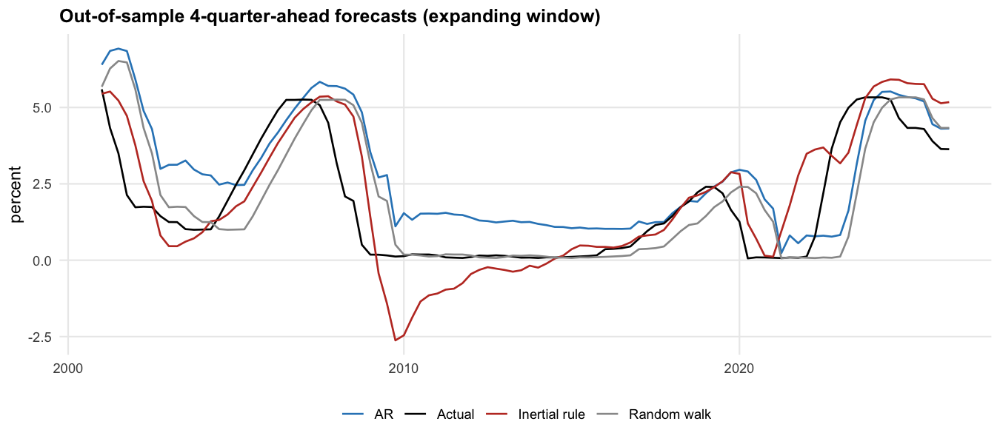

# Results report

Quarterly sample 1965Q1 to 2026Q2 (246 quarters); monthly sample 1965-01 to 2026-05 (737 months). Scenario jump-off 2026Q2: funds rate 3.63%, core PCE 3.10%, output gap 1.40%.

## 1. How much of the policy rate do the models explain?

| model | R2 (levels) | R2 (quarterly / monthly changes) |
|---|---:|---:|
| Taylor (1993), fixed coefficients | 0.494 | – |
| Taylor (1993), 1987Q3-2008Q2 only | 0.610 | – |
| Estimated Taylor rule (static) | 0.589 | – |
| Estimated Taylor rule, 1987Q3-2008Q2 | 0.685 | – |
| AR(1), quarterly | 0.943 | – |
| AR(4), quarterly (BIC choice) | 0.950 | – |
| Inertial Taylor rule, quarterly | 0.952 | 0.178 |
| AR(1), monthly | 0.981 | – |
| Inertial Taylor rule, monthly | 0.982 | 0.053 |

The inertial rule explains 98.2% of the monthly level of the funds rate and 95.2% quarterly, but AR(1) alone already explains 98.1% and 94.3%: the fit comes mainly from rate persistence. On *changes* the rule explains 5.3% (monthly) and 17.8% (quarterly).

### Estimated rules (Newey-West standard errors)

Static rule, full sample:

| term | estimate | std_error | t_value | p_value |
|---|---:|---:|---:|---:|
| (Intercept) | 0.447 | 0.533 | 0.838 | 0.403 |
| core_pce | 1.349 | 0.181 | 7.464 | 0.000 |
| output_gap | 0.320 | 0.134 | 2.389 | 0.018 |

Static rule, 1987Q3-2008Q2:

| term | estimate | std_error | t_value | p_value |
|---|---:|---:|---:|---:|
| (Intercept) | 0.877 | 0.624 | 1.407 | 0.163 |
| core_pce | 1.510 | 0.193 | 7.803 | 0.000 |
| output_gap | 0.975 | 0.132 | 7.395 | 0.000 |

Inertial rule, quarterly:

| term | estimate | std_error | t_value | p_value |
|---|---:|---:|---:|---:|
| (Intercept) | -0.026 | 0.131 | -0.197 | 0.844 |
| ff_lag | 0.904 | 0.027 | 33.776 | 0.000 |
| core_pce | 0.157 | 0.072 | 2.173 | 0.031 |
| output_gap | 0.146 | 0.028 | 5.215 | 0.000 |

Smoothing rho = 0.904 (half-life 6.8 quarters). Long-run responses: inflation 1.63 (s.e. 0.45), output gap 1.51 (s.e. 0.45). The long-run inflation response exceeds 1 (the Taylor principle).

## 2. Rate persistence across cycles (AR(1) by Fed chair)

| regime | start | end | quarters | mean_rate | sd_quarterly_change | rho | rho_low | rho_high | half_life |
|---|---|---|---:|---:|---:|---:|---:|---:|---:|
| Martin | 1965Q1 | 1970Q1 | 21 | 5.603 | 0.595 | 0.998 | 0.817 | 1.178 | 286.337 |
| Burns | 1970Q2 | 1978Q1 | 32 | 6.433 | 1.248 | 0.841 | 0.640 | 1.042 | 3.995 |
| Volcker | 1979Q4 | 1987Q3 | 32 | 10.567 | 1.768 | 0.879 | 0.693 | 1.066 | 5.395 |
| Greenspan | 1987Q4 | 2006Q1 | 74 | 4.787 | 0.488 | 0.971 | 0.920 | 1.021 | 23.214 |
| Bernanke | 2006Q2 | 2014Q1 | 32 | 1.437 | 0.402 | 0.941 | 0.872 | 1.011 | 11.486 |
| Yellen | 2014Q2 | 2018Q1 | 16 | 0.490 | 0.104 | 1.151 | 1.022 | 1.281 |  Inf |
| Powell | 2018Q2 | 2026Q2 | 33 | 2.663 | 0.518 | 0.966 | 0.869 | 1.063 | 20.087 |

## 3. Out-of-sample accuracy (expanding window from 2000Q1)

| h | n | rmse_random_walk | rmse_ar | rmse_inertial_taylor | oos_r2_levels_inertial | oos_r2_changes_inertial |
|---:|---:|---:|---:|---:|---:|---:|
| 1 | 105 | 0.458 | 0.444 | 0.421 | 0.955 | 0.151 |
| 4 | 102 | 1.526 | 1.679 | 1.205 | 0.586 | 0.374 |

The inertial rule's forecast uses the macro data that actually materialised, so it is a *conditional* forecast, the way it is used for scenarios.

## 4. Model limitations

| regime | quarters | rmse_taylor_1993 | mean_gap_taylor_1993 | rmse_inertial | max_abs_inertial |
|---|---:|---:|---:|---:|---:|
| All quarters | 246 | 2.62 | -1.03 | 0.80 | 5.76 |
| Core PCE inflation > 4% | 75 | 3.78 | -1.41 | 1.29 | 5.76 |
| Core PCE inflation <= 4% | 171 | 1.89 | -0.86 | 0.44 | 1.48 |
| 1970s Great Inflation (1965-1979Q2) | 58 | 3.16 | -2.53 | 0.92 | 3.03 |
| Volcker disinflation (1979Q3-1987Q2) | 32 | 2.80 | 2.02 | 1.63 | 5.76 |
| Great Moderation (1987Q3-2007Q4) | 82 | 1.31 | 0.07 | 0.38 | 1.03 |
| Zero lower bound quarters | 36 | 3.31 | -2.36 | 0.37 | 1.02 |
| 2021-2023 inflation surge | 12 | 6.32 | -5.76 | 0.57 | 1.02 |
| Top-decile output-gap swings | 25 | 2.90 | -0.47 | 1.76 | 5.76 |

Structural breaks (Bai-Perron, static rule): 1979Q3, 1991Q3, 2001Q3. sup-F = 128.0 (p < 0.001).

### Where systematic rules and Fed discretion diverged (|deviation from Taylor 1993| > 2pp for 2+ quarters)

| start | end | quarters | direction | mean_deviation | max_abs_deviation | mean_inflation | mean_output_gap |
|---|---|---:|---|---:|---:|---:|---:|
| 1966Q4 | 1969Q1 | 10 | looser than rule | -3.33 | 3.85 | 3.71 | 3.86 |
| 1971Q1 | 1971Q3 | 3 | looser than rule | -3.51 | 4.44 | 4.95 | -0.58 |
| 1972Q1 | 1972Q2 | 2 | looser than rule | -2.48 | 2.85 | 3.42 | 0.53 |
| 1974Q4 | 1978Q4 | 17 | looser than rule | -4.56 | 7.53 | 7.06 | -1.49 |
| 1981Q2 | 1984Q4 | 15 | tighter than rule | 3.64 | 6.42 | 5.92 | -3.68 |
| 2003Q4 | 2005Q1 | 6 | looser than rule | -2.47 | 2.92 | 1.95 | 0.05 |
| 2008Q2 | 2008Q3 | 2 | looser than rule | -2.25 | 2.40 | 2.16 | 0.04 |
| 2011Q4 | 2012Q4 | 5 | looser than rule | -2.31 | 2.74 | 1.85 | -2.69 |
| 2013Q3 | 2013Q4 | 2 | looser than rule | -2.14 | 2.23 | 1.51 | -2.08 |
| 2014Q2 | 2017Q1 | 12 | looser than rule | -2.42 | 2.71 | 1.47 | -1.06 |
| 2017Q4 | 2018Q3 | 4 | looser than rule | -2.24 | 2.32 | 1.79 | 0.26 |
| 2020Q4 | 2023Q3 | 12 | looser than rule | -5.82 | 9.72 | 4.19 | 0.72 |
| 2026Q1 | 2026Q2 | 2 | looser than rule | -2.63 | 2.71 | 3.05 | 1.39 |

## 5. Scenario rate paths (9 quarters, CCAR/DFAST layout)

| scenario | peak funds rate | trough funds rate | funds rate end | 80% band end | Taylor 1993 end | 2y end | 10y end | Baa spread end |
|---|---:|---:|---:|---|---:|---:|---:|---:|
| Baseline | 4.05 | 3.79 | 3.79 | 1.66-5.73 | 4.30 | 3.96 | 4.47 | 2.13 |
| Hawkish (inflation re-acceleration) | 6.44 | 4.00 | 6.44 | 4.34-8.50 | 7.00 | 6.45 | 6.36 | 1.86 |
| Dovish (recession) | 3.62 | 0.56 | 0.56 | 0.12-2.50 | 2.15 | 0.80 | 2.00 | 2.39 |

## 6. Market and credit risk translation

Expectations regressions (yield on average funds rate over the next 8 quarters + core inflation, 1987Q3 onward):

| yield | term | estimate | std_error | t_value | p_value |
|---|---|---:|---:|---:|---:|
| 2-year | (Intercept) | 0.739 | 0.406 | 1.824 | 0.070 |
| 2-year | exp_path | 1.005 | 0.079 | 12.652 | 0.000 |
| 2-year | core_pce | -0.136 | 0.290 | -0.471 | 0.638 |
| 10-year | (Intercept) | 2.451 | 0.594 | 4.126 | 0.000 |
| 10-year | exp_path | 0.797 | 0.112 | 7.107 | 0.000 |
| 10-year | core_pce | -0.169 | 0.406 | -0.416 | 0.678 |

Short-run pass-through of a 1pp funds-rate change within the quarter:

| series | beta | se | r2 |
|---|---:|---:|---:|
| dgs2 | 0.645 | 0.049 | 0.414 |
| dgs10 | 0.291 | 0.052 | 0.125 |
| dslope | -0.355 | 0.035 | 0.406 |

Baa spread model (chosen by BIC among 5 candidates: `gap_momentum`):

| spec | r2 | bic | terms |
|---|---:|---:|---|
| level_gap | 0.825 | 78.514 | spread_lag 0.830 (t 14.6); output_gap -0.015 (t -0.8); dff -0.264 (t -2.2) |
| gap_momentum | 0.846 | 64.006 | spread_lag 0.873 (t 15.8); d_gap -0.108 (t -2.8); output_gap 0.010 (t 0.6); dff -0.203 (t -2.0) |
| unemployment | 0.831 | 73.393 | spread_lag 0.887 (t 15.5); d_gap -0.132 (t -2.7); unemp_gap -0.004 (t -0.3) |
| policy_stance | 0.832 | 77.082 | spread_lag 0.872 (t 14.4); d_gap -0.135 (t -2.6); unemp_gap -0.011 (t -0.6); stance -0.014 (t -1.1) |
| curve_slope | 0.831 | 78.413 | spread_lag 0.888 (t 15.3); d_gap -0.131 (t -2.6); unemp_gap -0.003 (t -0.1); slope -0.003 (t -0.1) |

### Duration and spread P&L on $100m per position (end of horizon, price return)

| scenario | position | change_rate_bp | change_spread_bp | rate_pnl | spread_pnl | total_pnl |
|---|---|---:|---:|---:|---:|---:|
| baseline | 2-year Treasury | -0.9 | 0.0 | 0.0 | 0.0 | 0.0 |
| baseline | 10-year Treasury | 4.7 | 0.0 | -0.4 | 0.0 | -0.4 |
| baseline | 10-year Baa corporate | 4.7 | 51.3 | -0.4 | -3.9 | -4.3 |
| dovish | 2-year Treasury | -317.3 | 0.0 | 6.3 | 0.0 | 6.3 |
| dovish | 10-year Treasury | -242.6 | 0.0 | 21.9 | 0.0 | 21.9 |
| dovish | 10-year Baa corporate | -242.6 | 77.2 | 20.4 | -5.9 | 14.6 |
| hawkish | 2-year Treasury | 247.6 | 0.0 | -4.6 | 0.0 | -4.6 |
| hawkish | 10-year Treasury | 193.9 | 0.0 | -14.3 | 0.0 | -14.3 |
| hawkish | 10-year Baa corporate | 193.9 | 23.8 | -13.5 | -1.8 | -15.3 |

Portfolio totals ($m): baseline -4.6; dovish 42.7; hawkish -34.1.
